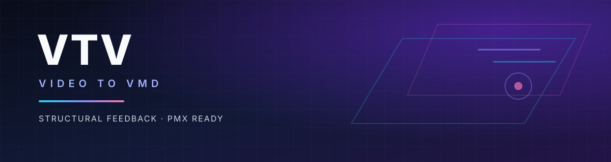

<div align="center">



# 视频 → VMD

**面向复杂 PMX 的结构化动作迁移、后馈纠正与可复现产线**

把单目舞蹈视频转换成可以直接套到复杂标准骨骼 PMX 上的 VMD。
不是“关键点换个骨名”，而是把**目标模型适配、结构后馈、长视频 QC、可复现导出**做成一条完整链路。

<p align="center">
  
  
  
  
</p>

<p align="center">
  
  
  
  
</p>

<p align="center">
  <code>#MMD</code> <code>#VMD</code> <code>#PMX</code> <code>#MotionCapture</code> <code>#StructuralFeedback</code> <code>#VideoToVMD</code>
</p>

**作者：SrQingChen**

</div>

---

## 这个项目解决什么

通用 video→VMD 工具通常停在“2D 关键点 → MMD 骨名 → 写 VMD”。但真正套到复杂 PMX 上时，问题往往不是“没有动作”，而是：

- 腿的 D 链、肩 P/C、捩骨、IK、rest pose 没有对齐，模型看起来像被拆开；
- 动作在局部看起来正常，但相对躯干是错的；
- 毛刺帧、深度翻转、遮挡恢复跳变；
- 单段能跑，长视频接缝处断裂；
- 输出只能在自己调试的模型上成立。

VTV 把这些**目标模型与结构问题**放在第一位，而不是只做一个关键点重定向器。

---

## 与传统 video→VMD 方案的差异

> 下表描述设计重点，不是对每个现有工具的同条件横评。

| 能力 | 常见方案 | VTV |
|---|---|---|
| 目标模型适配 | 骨名映射为主 | 每模型 PMX adapter：rest、P/C、D 链、twist、IK、缩放、morph 别名 |
| 错配诊断 | 主要靠肉眼 | compatibility report + safe writable-bone set；可定位到具体骨/继承/IK 项 |
| 后馈信号 | 原始关键点或平滑 | 结构残差网络；训练用配对 GT，推理不依赖像素/剪影 |
| 验证方式 | 视觉检查为主 | 合成配对 GT、整段留出、逐骨 + 接触 + 时序门禁 |
| 长视频 | 通常单段处理 | 10 秒段 + 1 秒重叠、根对齐、VMD 合并、接缝/段级 QC |
| 输出契约 | 身体轨或未知 helper | 53 轨（23 身体 + 30 手指）+ morph；IK off；无 D/helper；手指位移 0 |
| 可复现性 | GUI/云端黑盒 | CLI、缓存/断点、manifest、QC JSON/Markdown、固定机位证据 |

核心技术取向是 **跨身份结构后馈**：视频角色与目标 PMX 不可能共享外观，因此 RGB/剪影比对没有意义；VTV 在目标模型空间比较关节、肢体方向、接触和时序。

---

## 数据与结果

### 配对数据引擎

| 项目 | 当前结果 |
|---|---|
| 配对片段 | **77 段**（R1/R2/R3 × 3 模型 × 固定机位 + 训练专用视角/增强） |
| 数据划分 | **58 train / 10 val / 9 test**；R3 整段留出，不参与训练/调参 |
| 训练帧数 | **18,430 帧**（首个版本的 2.43 倍） |
| 手部监督 | **3,180 个 L0/L1 帧**（6,361 side-frames），从 462 帧扩展 |
| GT 构成 | 三模型身体 + 30 手指 + 每模型实际存在的 morph |
| 泄漏审计 | 按动作/模型/机位整段拆分，0 problems |
| 教师可达性 | v2 教师在 R3 上 **2.34° → 0.06°**，0 个因子被裁剪 |

### M6 v2 结构后馈（当前生产默认）

| 指标 | 基线（cleanup+IK+M3） | VTV v2 | 变化 |
|---|---:|---:|---:|
| R3 留出 body-relative main | 37.55° | **24.59°** | **−34.5%** |
| chest 组 | 43.67° | **12.76°** | −30.91° |
| upperarm 组 | 30.68° | **25.74°** | −4.94° |
| forearm 组 | 38.30° | **35.25°** | −3.05° |
| world angle（次要） | 68.65° | 67.79° | **−0.86°** |
| 3D position（次要） | 8.08%H | 7.95%H | **−0.13%H** |
| contact recall / slide / penetration | — | — | 逐值不变 |
| jerk ratio | 0.4226 | 0.4348 | +2.9% |

- **9/9 留出片段、3/3 模型、3/3 机位全部改善。**
- 按模型 A/B/C：37.72→24.94°、35.41→22.22°、39.52→26.59°。
- 按机位：front 38.30→23.85°，three-quarter 37.50→22.59°，side 36.86→27.31°。
- 网络：2.18M 参数 BiGRU，289 维证据 → 79 维有界残差；TCN/Transformer/MRN/Graph/per-factor 均比较，BiGRU 最好。
- 默认是 **one-shot** 结构残差后馈；2 轮 residual pass 已实现并评估，但没有稳定增益，因此不作为默认，也不称“闭环控制器”。
- full 手/脸后馈是 opt-in 实验，不是默认：手部 MAE 仍不如上一版 full，T5 手指步长会增加。

### 产线、长视频与输出

- 最终 VMD：**53 轨**（23 身体 + 30 手指）、4 个 IK 骨骼关、无 D/helper、手指位移 0、每模型 morph。
- T5 三模型 2K：D 链 **0/0**、verify **<2e-6**、scale warning 0。
- 长视频压力测试：**80.67 秒 / 2420 帧**，9 段 × 300 帧 + 30 帧重叠，**24/24 接缝**、**27/27 段级 QC** 通过；合并 jerk +2.56–3.19%，合并 VMD 仍 53 轨/IK off/无 D-helper。
- 一条命令输出 VMD + 2K before/after + QC + manifest；缓存、断点、单段重跑、窗口回退均已接入。

---

## 工作流

```text
视频
 → 30fps 归一化
 → 可选 10 秒分段（1 秒重叠）
 → GVHMR 证据
 → 每模型 PMX adapter
 → 选择性清理
 → 接触 / 腿 IK
 → 手 / 脸证据（L0–L3）
 → M6 v2 结构后馈（默认 torso .85 / arm .30；手/脸/根关）
 → VMD（53 轨、IK off、无 D/helper）
 → 2K 渲染 + QC
 → 长视频：根对齐 + smoothstep 合并 + 接缝/段级 QC
```

后馈发生在身体/手/脸装配之后、VMD 导出之前。高置信观测和未修改轨逐帧保留；变差的窗口回退到后馈前姿态，并在 QC 中记录，不静默覆盖。

---

## 快速开始

```bash
pip install -e .

# 短片段（T5 类）
python scripts/run_vtv.py \
  --video testdata/T5_高速舞蹈_001/001.mp4 \
  --out outputs/demo_t5 \
  --models <model_a>,<model_b>,<model_c> \
  --feedback v2 \
  --render

# 长视频：超过 10 秒自动切段、合并、段边界 QC
python scripts/run_vtv.py \
  --video <long_video.mp4> \
  --out outputs/demo_long \
  --models <model_a>,<model_b>,<model_c> \
  --feedback v2 \
  --render
```

常用开关：

- `--feedback v2`：生产默认。
- `--feedback default`：上一版 M3.5 保守模型。
- `--feedback off`：纯 `cleanup+ik+M3` 基线。
- `--feedback v2_full`：手/脸后馈实验，不默认。
- `--no-render`：只导出 VMD/QC。
- `--chunk-seconds`、`--overlap-seconds`、`--force-chunk`：长视频控制。

正式跑之前：

```bash
python scripts/check_env.py --models <model_a>,<model_b>,<model_c> --long
```

安装、输入格式、模型 profile、缓存、QC 读法和失败诊断见 [docs/M5_使用指南.md](docs/M5_使用指南.md)。

---

## 当前边界

| 模块 | 状态 |
|---|---|
| 身体 / PMX 适配 | 稳定；三模型；VMD/2K/QC |
| M6 v2 结构后馈 | 生产默认；R3 留出 main −34.5% |
| 手部 | 30 轨已输出；T5 可见 L0/L1 仍有限，fallback 平滑 |
| 表情 | 眨眼 + 程序化 fallback；完整表情集尚不可靠 |
| 长视频 | 80.7 秒拼接压力测试通过；真实连续长片在 M7 |
| 慢动作 + 多段 | 尚未支持；会明确拒绝 |
| 真人视频 | 尚未验证；M7/M8 |
| full 手/脸后馈 | opt-in；在 T5 稳定性/手部精度提升前不默认 |

**已明确保留的限制：** T5 没有 GT；长视频证据是拼接压力片，不是真实连续 take；手/脸覆盖受输入限制；24.59° 是显著改善，但仍不是“零人工修正”。

---

## 仓库结构

```text
src/vtv/
  cli.py                 CLI
  pipeline.py            阶段编排 / manifest / 缓存 / 断点
  longvideo.py           分段 / 对齐 / VMD 合并 / 接缝 QC
  framing.py             每模型自动取景
  feedback_apply.py      v2 残差应用 / 门控 / 回退
  feedback_net.py        BiGRU / TCN / Transformer / MRN / graph
  qc.py                  证书 / 稳定性 / 未变审计 / 次要指标
  mmd/                   PMX / VMD 读写 / Blender bake
scripts/                 一条命令、数据引擎、训练、评测、QC、渲染
configs/                 模型与管线配置
tests/                   单元 + 回归测试
docs/                    执行报告与开发指南
demo/                    发布 demo 清单（不含受限素材）
assets/                  README 视觉资源
```

---

## 开源协议

**项目代码：GNU GPL v3.0 only（GPL-3.0-only）。**
Copyright (C) 2026 **SrQingChen**。见 [LICENSE](LICENSE)。

第三方组件各自保留原协议，不被本项目重新授权：

- vendored `mmd2gltf` 代码保持 MIT；
- MediaPipe 运行时/模型保持 Apache-2.0；
- GVHMR / SMPL-X 及本项目训练的后馈 checkpoint 继承研究 / 非商业约束；
- Blender、MMD Tools、FFmpeg 是外部工具，遵循各自协议。

详见 [THIRD_PARTY_NOTICES.md](THIRD_PARTY_NOTICES.md) 与 [MODEL_LICENSES.md](MODEL_LICENSES.md)。

**不随仓库分发：** PMX 模型、SMPL/SMPL-X body models、GVHMR 权重、项目后馈 checkpoint、VMD/R1–R3 动作、T1–T5 视频。使用者需按各自许可自行获取。

---

## 文档

- [M6 执行结果：结构后馈 v2](docs/M6_执行结果_后馈网络增强.md)
- [M6.0 研究/benchmark](docs/M6.0_研究调研与benchmark.md)
- [M5 执行结果：长视频与发布候选](docs/M5_执行结果_长视频与发布候选.md)
- [M5 使用指南](docs/M5_使用指南.md)
- [M4 执行结果：产线集成](docs/M4_执行结果_产线集成与开源.md)
- [开发路线图 v2](开发路线图_v2.md)
- [第三方声明](THIRD_PARTY_NOTICES.md)
- [模型许可](MODEL_LICENSES.md)

---

<div align="center">

**VTV · Video to VMD**
Copyright (C) 2026 **SrQingChen** · GPL-3.0-only

</div>
